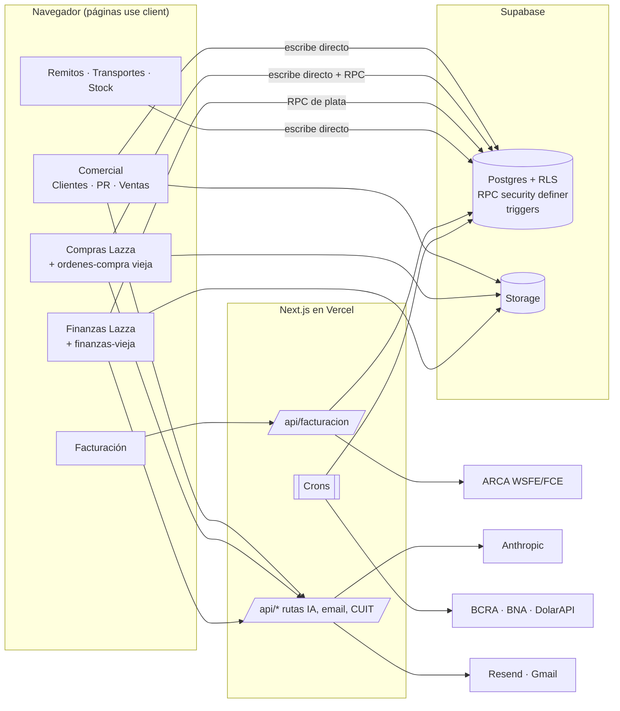
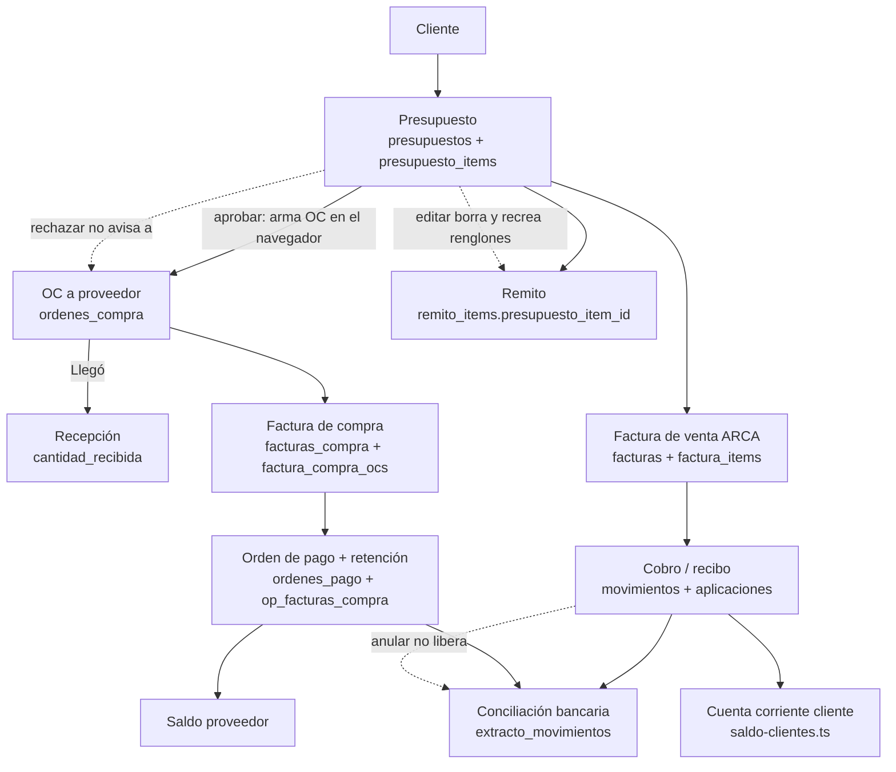

# 02 — Mapa de arquitectura

Relevado el 28/10/2026 sobre `main` (V1.1.595) más los cambios locales sin publicar. Rutas relativas a `crm/app/`.

## 1. Tecnologías

| Capa | Qué se usa |
|---|---|
| Front + servidor | Next.js 15 (App Router), React 18, TypeScript, Tailwind 4. Las páginas son `"use client"`: cargan datos en `useEffect` y escriben directo en Supabase desde el navegador |
| Base de datos | Supabase Postgres (proyecto `ycuzszzskqatlegtbgbq`): RLS, decenas de RPC `security definer` para operaciones de plata y triggers de recálculo. 176 migraciones en `supabase/migrations`, 127 con rollback |
| Archivos | Supabase Storage: `certificados`, `comprobantes`, `facturas-compra`, `presupuestos` y otros (5 buckets públicos) |
| Hosting | Vercel: 7 crons en `vercel.json` (cotización BNA x2, vencimiento de PR, BCRA, agente de mail x3) |
| IA | `@anthropic-ai/sdk` (Opus 5.5, con Sonnet de respaldo) en las rutas `/api/parse-*`, `/api/ai*`, asistentes, conciliación y agente de mail |
| Fiscal | ARCA/AFIP WSFE y WSFECRED (`lib/arca-wsfe-node.ts`, `lib/arca-wsfecred-node.ts`, `@ramiidv/arca-facturacion`), padrón para CUIT |
| Externos | BCRA Central de Deudores, BNA y DolarAPI (cotización), Resend (mail), Gmail de solo lectura (agente de mail) |
| Pruebas | ~160 scripts `scripts/test-*` que se corren a mano; `tsc --noEmit` y `check-hooks` dentro del build |

Tamaño: unos 360 archivos `.ts`/`.tsx` en `src`, con más de 100.000 líneas. Hay archivos gigantes: `app/(crm)/finanzas-vieja` (6.615 líneas), `components/presupuestos/presupuestos-lista.tsx` (4.870), `app/(crm)/ordenes-compra/page.tsx` (4.031) y `app/(crm)/clientes/page.tsx` (~2.500).

## 2. Módulos funcionales (descubiertos en el código)

| Grupo | Pantallas (`src/app/(crm)/…`) | Lógica (`src/lib`) | Tablas principales |
|---|---|---|---|
| Comercial | clientes (+ficha 360, BCRA), presupuestos, presupuestos-nuevo, oportunidades, muestras, personalizacion, pendientes, calendario, dashboard, ventas | presupuesto-*, oportunidades, ventas-*, dolar-presupuesto, resto-facturar, saldo-clientes | clientes, presupuestos, presupuesto_items, muestras, personalizacion_*, alertas, cliente_bcra_informes |
| Compras | compras-lazza (actual), compras-nueva, ordenes-compra (vieja, oculta pero viva por URL), proveedores, importaciones | compras-*, purchase-*, oc-*, factura-vs-oc, saldo-factura-compra, reemplazo-oc | ordenes_compra, orden_compra_items, facturas_compra, factura_compra_ocs, proveedor_equivalencias, lz_oc_ajustes |
| Finanzas | finanzas-lazza (actual), finanzas y finanzas-vieja (viejas, vivas por URL), facturas, mail-cobros | finanzas-*, saldo-*, cobro-*, cheques-*, op-*, orden-pago-*, plan-pagos, retencion-*, extracto-*, caja-proyectada | movimientos, aplicaciones, ordenes_pago, op_facturas_compra, cheques, cuentas, extracto_movimientos, gastos_manuales, pagos_lotes, certificados_retencion |
| Facturación | facturacion, consulta-facturas | arca-*, fiscal-*, fce-*, factura-*, invoice-*, sales-credit-note, estado-factura-venta | facturas, factura_items, fiscal_emission_attempts |
| Logística | remitos, transportes, stock, papelera | remito*, remitos-*, transportes-anotador | remitos, remito_items, productos, transportes |
| Configuración | configuracion (usuarios, permisos, uso de IA) | auth-context, ia-uso, ia-tope | profiles, usuario_sociedades |
| Servidor | `app/api/*` (27 grupos) y `app/api/cron/*` | agente-mail-server, bcra-server, email | agente_mail_procesados, cotizaciones_dolar, ia_acciones |

## 3. Diagrama general

Lo más importante de este dibujo: **casi todo escribe en la base directo desde el navegador**. Solo la plata nueva (cobros, OP, NC, conciliación de compras) pasa por RPC atómicas. Por eso la seguridad depende de las políticas RLS (ver H02 a H05) y las operaciones de varios pasos pueden quedar a medias (ver 07-causas-raiz).

## 4. Circuito comercial y financiero (cómo se conectan los módulos)

Las flechas punteadas son las conexiones rotas confirmadas (H06, H09, H15).

## 5. Módulos que deberían hablarse y no lo hacen

| Desde | Hacia | Qué falta | Hallazgo |
|---|---|---|---|
| Estado del PR (rechazado, no facturar, perdido) | Compras (OC) | No avisa ni propone cancelar OC: hay 4 OC pagadas de PR rechazados (≈ $19,1 M) | H09 |
| Edición del PR | OC, remitos, personalización | Se pierde el vínculo por renglón (35 renglones de OC y 47 de remito ya quedaron sueltos) | H06 |
| Anular cobro / borrar gasto | Conciliación bancaria | La línea del banco sigue conciliada contra un movimiento anulado | H15 |
| Factura autorizada por ARCA | Base / PR | Si falla el guardado no hay recuperación y el PR queda "facturado" | H13 |
| Compras Lazza (recepción) | Stock | La recepción vieja suma stock, la nueva no (hoy el stock no se usa: 0 productos) | H47 |
| Ejes de factura/pago de la OC | Ventas, IA, Finanzas vieja | Sin alimentar desde el 19/10 y todavía se leen | H50 |
| Saldo de cuenta del cliente | Presupuestos (límite de crédito) | Usa la columna vieja `saldo_cuenta_corriente` | H30 |

## 6. Lo que depende de servicios externos o de datos no consultables

- **ARCA**: no se llamó (regla de Augusto). El total "real" de cada comprobante se tomó de lo enviado y guardado en `fiscal_emission_attempts`.
- **Vercel**: no se miró la configuración real (plan, `maxDuration` efectivo ni qué variables existen). Solo se infiere que `CRON_SECRET` está, porque el cron de cotización escribe.
- **Anthropic, BCRA, BNA, Resend, Gmail**: no se llamaron. Las rutas se revisaron leyendo el código.
- **Storage**: se listó la configuración de buckets y políticas con SELECT, pero no se descargó ningún archivo.
