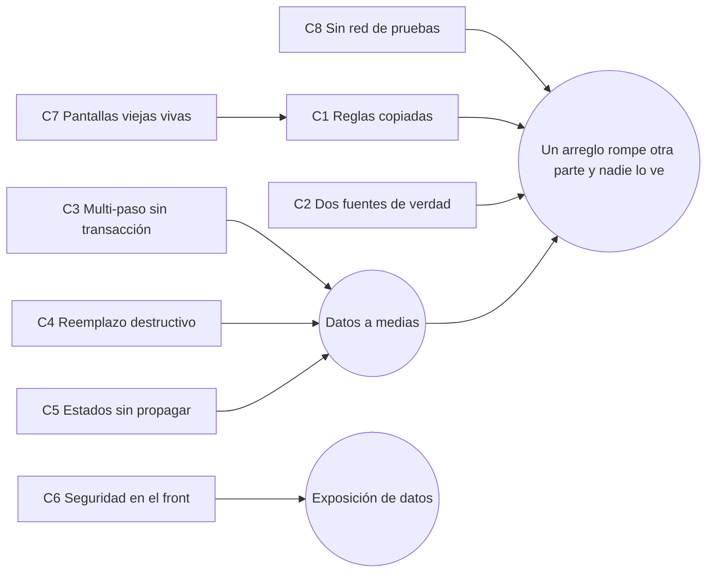

# 07 — Causas raíz

La pregunta de fondo es **por qué arreglar algo rompe otra cosa, o hace que el error aparezca en otro lado**. La auditoría encontró **8 causas estructurales**. Casi todos los hallazgos de [05](05-problemas-confirmados.md) son una consecuencia de alguna de ellas.

Para cada causa: **síntoma** (dónde se ve), **causa raíz** (qué lo provoca), **consecuencia** (qué más afecta), **por qué los arreglos anteriores no alcanzaron** y **solución estructural** (lo mínimo que lo corta de raíz).

---

## C1. La misma regla de negocio copiada en varios lugares

- **Síntoma:** el mismo número da distinto según la pantalla. Por ejemplo, la factura que Finanzas muestra en $0 y la base como deuda total (H19), o la Cta. Cte. del cliente que suma las NC como deuda (H08).
- **Causa raíz:** en vez de una función única, cada pantalla o RPC tiene su propia copia de la regla:

| Regla | Copias | Hallazgo |
|---|---|---|
| Saldo de factura de compra | 7 (RPC de OP, trigger validador, RPC de tarjeta, finanzas-lazza, saldo-proveedores, OP nueva, Plan de pagos) | H17, H18, H19 |
| Saldo de factura de venta | 6 (saldo-clientes / `lz_cobrado_factura`, RPC de NC, agente de mail, asistente de Finanzas, Cta. Cte. y Consumo del cliente) | H08, H28, H41 |
| Estado de mercadería de la OC | 4 | H10, H50 |
| Margen mínimo | 3 | H43 |
| Retención de Ganancias | 2 (OP y Plan de pagos) | H25, H26, H27 |
| Elegir FA o FB | 2 (modal y facturación masiva) | H32 |
| Cotización de la factura | 2 | H37 |
| Saldo a favor del cliente | 2 | H29 |
| Estados "ganados" del PR | 2 (`lib/oportunidades` y RPC del dashboard) | H39, H41 |

- **Consecuencia:** cada arreglo se hace en una copia y las demás siguen con la regla vieja. El error "se muda" a la pantalla que no se tocó.
- **Por qué no alcanzó lo anterior:** se arregló bien el núcleo (por ejemplo `saldo-clientes.ts` para el saldo de venta), pero no se buscaron y reemplazaron los otros consumidores.
- **Solución estructural:** una función por regla en `src/lib` (y su gemela SQL cuando la usa una RPC), con una prueba de "casos de oro" que compare todas las implementaciones que queden. Cuando haya que cambiar una regla, primero se busca por nombre dónde se calcula.

## C2. Dos fuentes de verdad para el mismo dato (una columna guardada y un cálculo)

- **Síntoma:** estados que no coinciden con la realidad. Hay OC "Completo" sin nada recibido (H10), factura de compra "pagada" sin pago (H19), un total de factura distinto del que autorizó ARCA (H12) y una línea del banco "conciliada" contra un movimiento anulado (H15, H80).
- **Causa raíz:** el dato existe dos veces. Por ejemplo `facturas_compra.estado` vs `fc_compra_pagado()`, `ordenes_compra.estado` vs `cantidad_recibida`, `clientes.saldo_cuenta_corriente` vs `saldo-clientes`, `facturas.total` vs el `ImpTotal` enviado a ARCA, y `conciliado` vs `match_movimiento_id`. Las excepciones de negocio (por ejemplo "ya pagada por otro medio") se implementan de un solo lado.
- **Consecuencia:** cada pantalla elige una de las dos y muestra cosas distintas.
- **Solución estructural:** decidir por escrito cuál es la verdad de cada dato (la tabla está en [08](08-matriz-dependencias.md)). La otra columna se calcula siempre desde la verdad o se deja de leer.

## C3. Operaciones de varios pasos armadas en el navegador, sin transacción

- **Síntoma:** procesos que quedan a medias. Un PR aprobado puede quedar con OC vacías o faltantes (H44), una OC editada a medias (H11), un remito dividido sin renglones (H14), un gasto sin su movimiento (H21) o una factura anulada sin propagación (H31).
- **Causa raíz:** la pantalla hace 3 a 6 escrituras seguidas. Si una falla (red, permiso, dato inválido), las anteriores ya quedaron guardadas, y muchas veces el error se muestra como aviso o ni se muestra (`continue` ante errores).
- **Consecuencia:** datos inconsistentes que aparecen días después en otro módulo.
- **Lo que ya está bien:** lo de plata nuevo (cobros, OP, NC, conciliación de compras) ya está en RPC atómicas e idempotentes, y anda bien. El resto todavía no.
- **Solución estructural:** pasar a RPC atómica cada operación que escribe en más de una tabla, empezando por **aprobar PR → OC** y **editar OC**, con el mismo patrón que ya funciona en cobros y OP.

## C4. Reemplazar en vez de actualizar, con vínculos que se borran solos

- **Síntoma:** después de editar un PR, lo remitido y lo comprado por renglón se calcula mal (H06). Hoy hay 35 de 463 renglones de OC y 47 de 364 renglones de remito que perdieron el vínculo con su renglón del PR.
- **Causa raíz:** `actualizar_presupuesto_atomico` borra todos los renglones y los vuelve a crear con ids nuevos, y además copia solo algunas columnas (H07). Las FK `ON DELETE SET NULL` dejan en silencio sin vínculo a OC, remitos, personalización y ajustes. Lo mismo pasa al dividir un remito, al borrar una factura de compra (cascada a la OP, H53) y al editar una OC (cascada a asignaciones).
- **Consecuencia:** emparejamiento por descripción o código, que falla si cambia el texto. Puede haber pedidos dobles y se pierde la trazabilidad.
- **Solución estructural:** actualizar por id (update de los que siguen, insert de los nuevos, delete solo de los sacados), copiando todas las columnas.

## C5. Estados que no se propagan entre módulos

- **Síntoma:** un módulo cambia de estado y el que depende de él no se entera. Pasa con el PR rechazado y sus OC vivas (H09), el cobro anulado y su línea del banco conciliada (H15), la factura autorizada pero no guardada con el PR "facturado" (H13), y los ejes de factura/pago de la OC sin alimentar desde el 19/10 (H50).
- **Causa raíz:** no hay un lugar único que diga "cuando pasa X, avisar a Y". Cada pantalla resuelve su parte.
- **Solución estructural:** una función por evento de negocio (venta caída, anular cobro, anular factura) que haga o **avise** todo lo que corresponde, siempre como aviso y nunca como bloqueo (regla 1 de Augusto).

## C6. Seguridad y separación por sociedad delegadas a la pantalla

- **Síntoma:** cualquiera con la dirección pública de Supabase y la clave anónima puede leer y escribir cosas que no debería. La clave anónima está, por diseño, dentro de la página que baja cualquier navegador. Hoy puede:
  - leer `v_facturas_pendientes` y `v_presupuestos_completos` (H02);
  - escribir la cotización del dólar (H01);
  - ejecutar funciones `security definer` como `increment_stock` o `get_dashboard_kpis` (H03);
  - listar comprobantes y facturas de compra del Storage (H04).

  Además, en las tablas viejas un usuario de una sociedad puede ver o tocar datos de la otra (H05).
- **Causa raíz:** las políticas RLS de las tablas viejas son `true` o solo miran el rol, las vistas no tienen `security_invoker`, a las funciones no se les sacó el permiso de `anon`, y los buckets son públicos. El filtro por `sociedad_id` está en el front.
- **Solución estructural:** migraciones (con rollback) que cierren `anon`, pongan `security_invoker` en las vistas y agreguen el filtro por sociedad en RLS. Los buckets pasan a privados con URL firmada.

## C7. Pantallas viejas vivas por URL con su propia lógica de escritura

- **Síntoma:** un arreglo hecho en la pantalla nueva no llega a la vieja. Por ejemplo, la recepción vieja suma stock y la nueva no (H47); hay dos circuitos de carga de facturas de compra y uno no controla duplicados (H51).
- **Causa raíz:** `finanzas-vieja`, `finanzas`, `ordenes-compra`, la carga masiva y `cargar-factura-oc` siguen accesibles por URL y escriben las mismas tablas con reglas distintas, aunque estén ocultas en el menú.
- **Solución estructural:** dejar las pantallas viejas en solo lectura o redirigirlas a la nueva (una "mudanza", sin borrar nada).

## C8. No hay red de seguridad automática

- **Síntoma:** un cambio rompe otra parte y nadie se entera hasta que lo ve un usuario.
- **Causa raíz:**
  - Fallan 13 de las 23 pruebas de `test:regressions` (leen texto de archivos que se mudaron) y ninguna corre en el build (H16).
  - Los tipos de la base son del 08/10 y les faltan unas 60 tablas, y hay 550 `supabase as any`. Por eso se pudo escribir un estado de OC que no existe (`'pendiente'`) sin que nada avisara (H49, H56).
  - Las migraciones no se registran desde el 08/10 (H83).
  - `tsc` da 0 errores, pero no protege las consultas.
- **Solución estructural:** ver [10-estrategia-de-testing.md](10-estrategia-de-testing.md). Es lo primero que conviene hacer, porque protege todos los arreglos que vienen después.

## C9 (menor). Triggers de recálculo sin guardas

`recalcular_factura` reescribe el total de comprobantes que ya tienen CAE (H12). `auto_estado_oc` solo sube el estado y nunca lo baja (H10). `recalcular_saldo_*` mantiene columnas que ya no son la verdad (H30). Solución: que el trigger no toque comprobantes con CAE y que el estado de la OC se calcule igual en las dos direcciones.

---

## Cómo se relacionan

**Conclusión:** el problema es estructural, pero **localizado**: no hace falta reescribir el CRM. Atacando C8, C1 y C2 en las reglas de plata se corta la mayor parte de los errores "que se mudan". C6 es independiente y conviene cerrarlo primero por seguridad.
