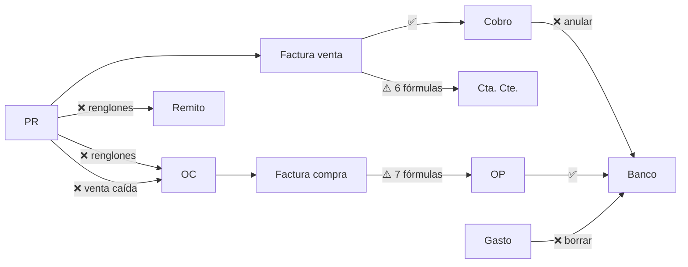

# 08 — Matriz de dependencias y fuentes de verdad

## Matriz de dependencias entre procesos

Fila = proceso que **escribe**; columna = proceso que **lee o depende**. ✅ conexión coherente · ⚠️ funciona con reglas distintas o sin propagar · ❌ conexión rota confirmada · — sin relación directa.

| Escribe ↓ / Lee → | PR | OC | Remito | Factura venta | Cobro | Banco | Fact. compra | OP / retención | Cta. Cte. cliente | Dashboard |
|---|---|---|---|---|---|---|---|---|---|---|
| **PR** | — | ❌ H06 H09 H44 | ❌ H06 | ⚠️ H57 | — | — | — | — | ⚠️ H30 | ⚠️ H39 |
| **OC** | ⚠️ H42 | — | — | — | — | — | ⚠️ H50 | — | — | — |
| **Remito** | ⚠️ H14 | — | — | ✅ | — | — | — | — | — | — |
| **Factura venta (ARCA)** | ⚠️ H13 | — | — | — | ✅ | — | — | — | ⚠️ H08 H28 | ⚠️ H41 |
| **Cobro** | — | — | — | ✅ (RPC atómica) | — | ❌ H15 | — | — | ⚠️ H29 | ✅ |
| **Banco (extracto)** | — | — | — | — | ⚠️ H80 | — | — | ⚠️ H80 | — | — |
| **Factura compra** | — | ⚠️ H10 H51 | — | — | — | — | — | ⚠️ H17 H19 H53 | — | — |
| **OP / retención** | — | — | — | — | — | ✅ | ⚠️ H17 H18 H22 | ⚠️ H25 H26 | — | — |
| **Gasto** | — | — | — | — | — | ❌ H15 H21 | — | — | — | — |

## Fuente única propuesta por dato compartido

| Dato | Fuente única propuesta | Consumidores a alinear |
|---|---|---|
| Saldo factura venta | `lz_cobrado_factura` / `saldo-clientes.ts` | NC RPC, agente-mail, asistente Finanzas, Clientes Cta. Cte. y Consumo |
| Saldo factura compra | `fc_compra_pagado` (+ decidir "pagada por otro medio" como ajuste registrado) | RPC OP modo OP, trigger validador, RPC tarjeta, finanzas-lazza, saldo-proveedores, OP, Plan |
| Estado mercadería OC | renglones (cantidad_recibida) + trigger único que suba y baje | oc-lista, Llegó, edición, mover renglones, syncOCsFromPR |
| Renglón del PR | id estable (upsert por id) | OC, remitos, personalización, ajustes |
| Total de factura | lo enviado a ARCA | trigger recalcular_factura, PDF/QR, IVA |
| Línea de banco | match_movimiento_id liberado al anular | gestionar_cobro, borrar gasto, rechazo de cheque |
| Saldo a favor cliente | un solo tipo de registro (ajuste crédito) | CC, Aplicar saldo a favor, NC |
| Cotización | tabla escrita solo por servidor | presupuestos, FX, facturación |

## Conexiones entre módulos relevadas por los agentes (100: 34 incompatibles, 34 dudosas, 32 compatibles)

*¿Compatible?*: **si** = leen y escriben el dato con la misma regla; **no** = reglas o fuentes distintas; **dudoso** = no se pudo cerrar.

| Desde | Hacia | Dato | Fuente de verdad | ¿Compatible? | Nota | Agente |
|---|---|---|---|---|---|---|
| Presupuestos (rechazo/No facturar/perdido) | Compras | venta caída | presupuestos.estado | no | No se propaga; 4 OC recibidas y pagadas de PR rechazados (H3) | A1 Comercial |
| Facturación/Finanzas | Clientes > Cta. Cte. | deuda del cliente | facturas.estado='emitida' (debería ser lib/saldo-clientes) | no | Incluye NC y omite parciales (H2) | A1 Comercial |
| Presupuestos | Dashboard | tasa de conversión | get_dashboard_kpis | no | Solo cuenta 'aprobado' (H6) | A1 Comercial |
| Presupuestos (trigger) | Alertas/Dashboard | aviso de PR aprobado/rechazado | alertas | no | Sin sociedad_id (H11) | A1 Comercial |
| Muestras | Facturación | prendas que se quedó el cliente | muestra_envio_items.cantidad_vendida | no | No hay vínculo ni lista para cobrar | A1 Comercial |
| Pago con tarjeta | Finanzas / CC proveedor | monto cancelado | fc_compra_pagado | no | RPC de tarjeta suma NC dos veces (H5) | A2 Compras |
| Llegó / editar OC | Lista de OC | estado de mercadería | orden_compra_items.cantidad_recibida | no | La lista confía en ordenes_compra.estado (H1) | A2 Compras |
| Mover renglones (oc-sin-proveedor) | OC origen y destino | estado y asignaciones | renglones | no | No recalcula estado ni orden_compra_id de asignaciones (H1, H3) | A2 Compras |
| Proveedores | Compras, Finanzas, Transportes | identidad del proveedor (CUIT) | proveedores (índice cuit+sociedad) | no | CUIT sin normalizar genera duplicados (H6) | A2 Compras |
| Transportes / Personalización | Facturas de compra | factura de compra | inserts directos | no | Sin control de duplicado; caso Speed Business (H9) | A2 Compras |
| Recepción vieja | Stock | stock de productos | increment_stock | no | Lazza no mueve stock; la vieja suma de más (H11) | A2 Compras |
| Gastos | Bancos / Caja / Reportes | egreso del gasto | movimientos.gasto_manual_id | no | 4 gastos sin movimiento; alta y borrado sin transacción (H2). | A3 Finanzas |
| Finanzas (saldo CC clientes) | Presupuestos (aviso de límite de crédito) | saldo del cliente | calcularSaldosClientes | no | Presupuestos lee clientes.saldo_cuenta_corriente, una columna muerta (H8). | A3 Finanzas |
| Emisión ARCA | Finanzas / saldos de clientes | total de la factura | ARCA ImpTotal vs facturas.total recalculado por trigger | no | H1: 20 comprobantes difieren en centavos | A4 Facturación y logística |
| Transportes | Compras / Finanzas | tipo de factura de compra | facturas_compra.tipo | no | H10: se guarda 'mercaderia', los datos existentes dicen 'transporte' | A4 Facturación y logística |
| Facturas | PDF / QR ARCA | importe | facturas.total | no | El QR usa el total local, distinto del autorizado (H1) | A4 Facturación y logística |
| Facturación masiva | ARCA | tipo FA/FB | tipoFacturaPorCondicionIva (modal) vs regla local | no | H7: monotributistas | A4 Facturación y logística |
| agente-mail | Cuentas corrientes | saldo de factura de venta | saldo-clientes.ts (cobradoPorFactura/saldoFacturaVenta) | no | Formula propia sin cobros directos ni anulados (H5). | A5 Integraciones e IA |
| finanzas/asistente | Cuentas corrientes | saldo de factura de venta | saldo-clientes.ts | no | Misma formula paralela (H5). | A5 Integraciones e IA |
| ai-presupuesto | Presupuestos | catalogo y costo de articulos | catalogo_crm.csv / lista de costos | no | Lee lista_precios_items sin sesion: vacio (H3). | A5 Integraciones e IA |
| /api/cotizacion-bna (pública) | Facturación USD, Presupuestos, Finanzas | cotización del dólar | cotizaciones_dolar | no | Escribible por anon; la confianza se basa en columnas que el anónimo controla. | A6 Base y seguridad |
| Compras / Finanzas vieja (front directo) | Saldo proveedor / Finanzas Lazza | estado y saldo de factura de compra | facturas_compra.estado vs fc_compra_pagado() | no | 3 pagadas sin pago y 1 pagada de más $219.548. | A6 Base y seguridad |
| Triggers de movimientos | Clientes / Presupuestos (aviso de límite) | saldo de cuenta corriente | clientes.saldo_cuenta_corriente vs cálculo real del front | no | 24 clientes distintos; Presupuestos usa el valor viejo. | A6 Base y seguridad |
| Mails (email/send) | Storage | adjuntos | URLs públicas de buckets | no | Buckets públicos y listables por anon. | A6 Base y seguridad |
| Presupuestos | Remitos | presupuesto_items.id | presupuesto_items | no | IDs cambian al editar el PR; 47 renglones de remito huérfanos (H2) | A7 Flujos y fuentes de verdad |
| Presupuestos | Compras/OC | presupuesto_items.id | presupuesto_items | no | 35 renglones de OC sin vínculo, 16 por edición del PR | A7 Flujos y fuentes de verdad |
| Presupuestos (UI) | Presupuestos (base) | descuento_porcentaje, precio_lista, catalogo_id | presupuesto_items | no | Los RPC no guardan esas columnas (H3) | A7 Flujos y fuentes de verdad |
| Notas de crédito | Cobros / CC | saldo a favor | facturas.saldo_a_favor_cliente vs movimientos ajuste crédito | no | CC lo muestra, cobro no lo puede aplicar (H4) | A7 Flujos y fuentes de verdad |
| Cobros / Gastos | Conciliación bancaria | vínculo con línea de banco | extracto_movimientos.match_movimiento_id | no | Anular no libera la línea; 4 líneas $2,1 M (H1) | A7 Flujos y fuentes de verdad |
| Movimientos | Clientes / Proveedores | saldo_cuenta_corriente | cálculo TS (saldo-clientes / saldo-proveedores) | no | Columna legacy con otra fórmula; Presupuestos la usa para límite (H10) | A7 Flujos y fuentes de verdad |
| facturas_compra.estado | fc_compra_pagado (RPC de pagos) | factura pagada | dos fuentes | no | 3 facturas de Grupo LA están 'pagada' sin ningún rastro de pago: Finanzas las da en 0 y la SQL las cuenta como deuda. | A8 Arquitectura y QA |
| Compras vieja (ordenes-compra:1014) | Compras Lazza (compras-lazza-llego.tsx) | recepción / stock | orden_compra_items.cantidad_recibida | no | La vieja mueve stock con increment_stock y la nueva no. | A8 Arquitectura y QA |
| scripts/test-* (12 archivos) | src/app/(crm)/finanzas/page.tsx | handlers de OP y pago directo | archivo movido a finanzas-vieja | no | Los tests apuntan al archivo equivocado desde el commit 99d0967. | A8 Arquitectura y QA |
| database.types.ts | todo el front | esquema de tablas | migraciones SQL | no | Faltan 61 o más tablas, y faltan columnas como proveedores.sociedad_id. | A8 Arquitectura y QA |
| Presupuestos | Compras (OC) | renglones a comprar | presupuesto_items → orden_compra_items.presupuesto_item_id | dudoso | Se corta al editar el PR (H1) y las monedas mezcladas suman como pesos (H8) | A1 Comercial |
| Presupuestos | Remitos | cantidad remitida por renglón | remito_items.presupuesto_item_id | dudoso | 47 renglones sin vínculo; el respaldo usa descripción+orden | A1 Comercial |
| Presupuestos | Personalización | renglón personalizado | personalizacion_items.presupuesto_item_id | dudoso | Queda NULL al editar el PR | A1 Comercial |
| Facturación (resto) | Ventas | resto a facturar | presupuesto_restos_facturar | dudoso | Ventas no lo muestra (H12) | A1 Comercial |
| Personalización | Finanzas | deuda con el taller (FC Manual) | facturas_compra | dudoso | Liquidación multi-paso con compensación manual | A1 Comercial |
| Compras Lazza (cargar factura) | Finanzas (vencimientos, CC, OP) | saldo de factura de compra | facturas_compra + fc_compra_pagado | dudoso | Finanzas trata 'pagada' como saldo 0; la base no (H4) | A2 Compras |
| Facturas / OP | OC (estado_facturacion, estado_pago) | OC facturada/pagada | trigger lz_actualizar_fact_pago_oc | dudoso | Sin vínculo factura-OC desde 19/10 (H7) | A2 Compras |
| OC (ejes factura/pago) | Ventas, Finanzas vieja, IA | OC pagada con tarjeta / facturada | ordenes_compra.estado_pago | dudoso | Datos congelados para OC nuevas (H7) | A2 Compras |
| Editar OC (Compras Lazza) | Presupuestos | proveedor y costo del renglón | cliente sin transacción | dudoso | Puede quedar distinto si falla a mitad (H3) | A2 Compras |
| Compras Lazza (carga de FC/NC) | CC proveedores / OP / Plan de pagos | saldo de factura de compra | fc_compra_pagado (declarada), con 6 copias más | dudoso | Hoy coincide porque las NC dejan doble rastro; ver H1. | A3 Finanzas |
| OP / Plan de pagos | Retenciones / SICORE / certificado | base, retención y régimen congelado | ordenes_pago.retencion_ganancias_* y base_retencion_ganancias | dudoso | El Plan no anota el régimen y usa la retención del momento del armado (H5, H7). | A3 Finanzas |
| Notas de crédito (RPC SQL) | lib/saldo-clientes.ts | cobrado por factura | dos implementaciones (SQL y TS) | dudoso | H5: reglas distintas, hoy sin casos | A4 Facturación y logística |
| Emisión / facturación masiva | Presupuestos | estado facturado | update desde el navegador | dudoso | H2/H11: marca facturado aun con reconciliation_required | A4 Facturación y logística |
| Remitos | Estado de entrega del PR | cantidades remitidas | remito_items | dudoso | H4: dividir puede dejar remitos sin renglones | A4 Facturación y logística |
| Recepción de OC | Stock | cantidad recibida | productos.stock vía increment_stock | dudoso | Sin kardex ni sociedad; productos vacío | A4 Facturación y logística |
| cron/cotizacion y /api/cotizacion-bna | Facturacion (api/facturacion:428) | tipo de cambio de factura USD | cotizaciones_dolar + BNA en vivo | dudoso | Facturacion prioriza BNA en vivo sobre la carga manual; tabla escribible por anon (H1, H6). | A5 Integraciones e IA |
| parse-lista-precios | Proveedores > listas | precios de proveedor | catalogo_crm.csv (regla 7) | dudoso | Via paralela de precios por IA (H7). | A5 Integraciones e IA |
| email/send | Facturacion, Finanzas, Compras, Remitos | constancia de envio | registro de cada pantalla en onSuccess | dudoso | Envio y registro no atomicos. | A5 Integraciones e IA |
| Storage | Email, Compras, Retenciones | archivos PDF/fotos | buckets de Supabase | dudoso | Publicos; facturas-compra escribible por anon (H2). | A5 Integraciones e IA |
| ia_uso | Configuracion > Uso de IA y tope de Ayuda | costo de IA | ia_uso + precios en codigo | dudoso | Tres tablas de precios distintas (H8). | A5 Integraciones e IA |
| OP (RPC y trigger) | Facturas de compra | aplicado vs total | validar_saldo_aplicacion_factura_compra vs fc_compra_pagado | dudoso | El validador no descuenta NC. | A6 Base y seguridad |
| auth-context (front) | RLS | sociedades permitidas | user_sociedades | dudoso | Sin filas: front muestra todas, base no deja ninguna (no-admin). | A6 Base y seguridad |
| Recepción de OC / Stock | Productos | stock | increment_stock | dudoso | RPC ejecutable por anon, sin sociedad ni rol. | A6 Base y seguridad |
| Transportes | Facturas de compra / OP | número de factura de compra | facturas_compra (sin índice único por diseño) | dudoso | FC A 4240-00004929 pagada dos veces en OP-000044. | A6 Base y seguridad |
| Migraciones (archivos) | Base real | objetos de esquema | pg_proc / pg_trigger | dudoso | Trigger de 20261007113000 ausente; registro cortado al 08/10. | A6 Base y seguridad |
| Facturación | Presupuestos | estado facturado | presupuestos.estado | dudoso | Masiva lo marca en update aparte desde el navegador; NC total lo vuelve a facturar | A7 Flujos y fuentes de verdad |
| Facturación | Libro IVA / Finanzas IVA | neto e IVA | facturas (recalculado por trigger) | dudoso | 24/145 con IVA distinto en centavos de lo enviado a ARCA (H6) | A7 Flujos y fuentes de verdad |
| Notas de crédito | Facturas de venta | total_acreditado | facturas.total_acreditado | dudoso | La NC calcula cobrado con fórmula propia (H7) | A7 Flujos y fuentes de verdad |
| Cheques | Cobros / Facturas | anulación del cobro por rechazo | echeqs → gestionar_cobro | dudoso | Hereda H1 si el cheque estaba conciliado | A7 Flujos y fuentes de verdad |
| Facturas de compra | Órdenes de pago / Plan de pagos | saldo pendiente | fc_compra_pagado / RPC / TS | dudoso | Tres reglas (H5); hoy coinciden salvo 3 'pagada' sin pago | A7 Flujos y fuentes de verdad |
| Órdenes de pago | Conciliación bancaria | conciliado | movimientos.conciliado | dudoso | El RPC lo pone true sin banco (H9) | A7 Flujos y fuentes de verdad |
| Finanzas (lib/finanzas-lazza.ts:482) | OP nueva (orden-pago-nueva.tsx:317) | saldo de factura de compra | ninguna única (fc_compra_pagado en SQL / copias en JS) | dudoso | La OP ignora total_acreditado. Hoy hay 0 casos afectados. | A8 Arquitectura y QA |
| Finanzas (lib/finanzas-lazza.ts:482) | Plan de pagos (plan-pagos.tsx:176) | saldo de factura de compra | ninguna única | dudoso | Misma omisión que la OP. | A8 Arquitectura y QA |
| Plan de pagos (lib/plan-pagos.ts:65) | OP nueva (:510-580) | retención Ganancias | lib vs copia inline | dudoso | En honorarios redondean distinto. | A8 Arquitectura y QA |
| Facturación | Presupuestos | estado facturado | presupuestos.estado='facturado' + facturas.presupuesto_id | si | Hoy 119/119 coinciden | A1 Comercial |
| Facturación/Finanzas | Ventas | saldo por factura | lib/saldo-clientes | si | Misma regla que Finanzas | A1 Comercial |
| Lista de costos | Presupuestos | costo y moneda de costo | catalogo_costos / catalogo_proveedores | si | Cotización y armado con IA usan la misma lista | A1 Comercial |
| BCRA | Presupuestos/Clientes | semáforo del cliente | cliente_bcra_informes | si | Aviso al aprobar, nunca bloquea | A1 Comercial |
| Carga masiva / conciliación | Presupuestos | costo y margen del renglón del PR | guardar_conciliacion_compra | si | Atómico; Compras Lazza no toca costos por diseño | A2 Compras |
| Cerrar saldo OC | Presupuestos (alertas) | aviso al vendedor | trigger lz_trg_saldo_cerrado_oc | si | Con permiso y sociedad | A2 Compras |
| Facturación (ARCA, NC venta) | Finanzas Facturas / CC clientes | facturas, total_acreditado, saldo_a_favor_cliente | facturas + lz_cobrado_factura / cobradoPorFactura | si | Verificado contra datos: estado guardado y saldo calculado coinciden en las 120 facturas vivas. | A3 Finanzas |
| Cobros (registrar_cobro_masivo_*, aplicar_saldo_favor_cliente) | CC clientes / Facturas / Recibos | cobrado por factura | movimientos + cobro_aplicaciones | si | TS ignora movimientos directos en otra moneda y la base no; hoy no hay casos. | A3 Finanzas |
| Extracto BBVA (aplicar_cruces_extracto) | Cheques / Bancos / Facturas | cheque cobrado, movimiento conciliado | extracto_movimientos + echeqs.estado | si | Es el único lugar que pasa cheques a cobrado, como pide la regla de Augusto. | A3 Finanzas |
| Finanzas vieja | Finanzas Lazza | saldos de CC de clientes y proveedores | lib/saldo-clientes y lib/saldo-proveedores | si | Solo difieren en los ajustes legacy [Ajuste manual] sin ajuste_sentido; hoy hay 0. | A3 Finanzas |
| Saldo a favor de proveedor / OP anticipo | CC proveedores | créditos a favor | saldos_favor_proveedor + OP sin facturas + ajustes | si | La misma regla en TS (creditosProveedor) y en la base (aplicar_saldo_favor_proveedor). | A3 Finanzas |
| Anular OP | NC compra / Plan de pagos / Cheques | reversión de NC, renglón del plan y estado de los cheques | anular_orden_pago_segura (20261026180000) | si | Revierte movimiento y total_acreditado y reabre el renglón con clave nueva. Los cheques no cambian (por diseño). | A3 Finanzas |
| Notas de crédito | Factura origen | total_acreditado / estado | RPC registrar_nota_credito_venta_autorizada | si | Atómica. Las NC legacy tienen credito_aplicado=0 y la NC externa 0001-25 anula 3 facturas pero está atada a una | A4 Facturación y logística |
| NC total | Presupuestos | estado facturar | RPC (misma transacción) | si | Correcto | A4 Facturación y logística |
| Emisión FCE | Remitos | números de remito del PR | remitos.presupuesto_id | si | facturas.remito_id y remitos.factura_id existen pero nadie los usa | A4 Facturación y logística |
| Remitos | Transportes | viaje del remito | transportes.remito_id | si | Anular cancela los viajes no liquidados y avisa por los liquidados | A4 Facturación y logística |
| /api/cotizacion-bna | Presupuestos / Finanzas | dolar del dia | cotizaciones_dolar | si | Cache confiable = manual o 'BNA historico v2'. | A5 Integraciones e IA |
| agente-mail | Finanzas > correo | sugerencias de cobro y clasificacion de mails | agente_mail_procesados | si | Solo sugiere; no registra cobros. | A5 Integraciones e IA |
| cron/bcra y /api/bcra | Presupuestos, Facturacion, ficha 360 | semaforo BCRA | cliente_bcra_informes / proveedor_bcra_informes | si | Solo aviso, unico por entidad y mes. | A5 Integraciones e IA |
| cron/presupuestos-vencimiento | Presupuestos | estado vencido | presupuestos.estado | si | No vence aprobados; idempotente. | A5 Integraciones e IA |
| ia-acciones (modo Hacer) | Compras | cantidad_recibida y estado de OC | estadoPorRecibido (compras-recepcion.ts) | si | Misma regla que 'Llego' de Compras Lazza; update y recalculo no atomicos. | A5 Integraciones e IA |
| ia-acciones (modo Hacer) | Pagos | CBU/alias/titular del proveedor | proveedores | si | Solo super_admin, con historial y Deshacer. | A5 Integraciones e IA |
| conciliar-compra | Compras (conciliacion) | equivalencias factura-OC | purchase-matching.ts + proveedor_equivalencias | si | IA validada contra grupos; cantidades y talles por reglas fijas. | A5 Integraciones e IA |
| finanzas/clasificar-lineas | Finanzas > Para confirmar | clasificacion de lineas del banco | finanzas_propuestas | si | Valida ids y valores; queda como propuesta. | A5 Integraciones e IA |
| RPC de cobros | Facturas de venta | estado de factura | lz_cobrado_factura / lz_estado_factura_por_cobro | si | 0 discrepancias en ARS y USD. | A6 Base y seguridad |
| Presupuestos | Facturación | ítems y total | presupuesto_items | si | 8 PR con total distinto de lo facturado: re-facturaciones, NC y restos, explicables | A7 Flujos y fuentes de verdad |
| Cobros | Facturas de venta | cobrado y estado | movimientos + cobro_aplicaciones (lz_cobrado_factura) | si | Misma regla en SQL y TS; 0 diferencias de estado en 120 facturas | A7 Flujos y fuentes de verdad |
| Facturas de compra | OC proveedor | estado_facturacion / estado_pago | facturas_compra + factura_compra_ocs/asignaciones | si | Trigger y copia en conciliación; coinciden 11/11 y en 187 OC | A7 Flujos y fuentes de verdad |
| Órdenes de pago | CC proveedores | aplicado, retención, saldo a favor | op_facturas_compra + saldos_favor_proveedor | si | Bruto = aplicado + saldo a favor; cuadra | A7 Flujos y fuentes de verdad |
| Órdenes de pago | SICORE / certificados | retención Ganancias | ordenes_pago.retencion_ganancias_* | si | Coincide con el movimiento de retención en 90/90 OP vigentes | A7 Flujos y fuentes de verdad |
| Órdenes de pago | Cheques | entregado / endosado | echeqs.estado | si | Anular OP no cambia cheques (decisión de negocio) | A7 Flujos y fuentes de verdad |
| lib/saldo-clientes.saldoFacturaVenta | lib/finanzas-lazza.facturasACobrar:843 | saldo de factura de venta | lib/saldo-clientes | si | Es la misma fórmula, pero copiada en lugar de llamar a la función. | A8 Arquitectura y QA |
